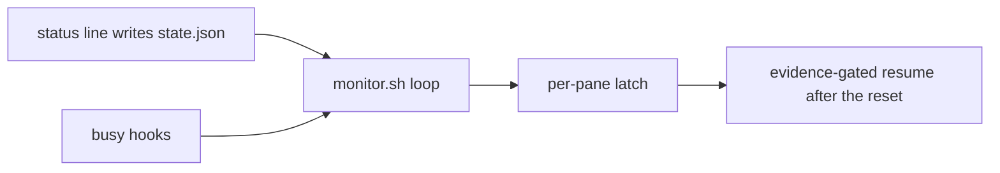
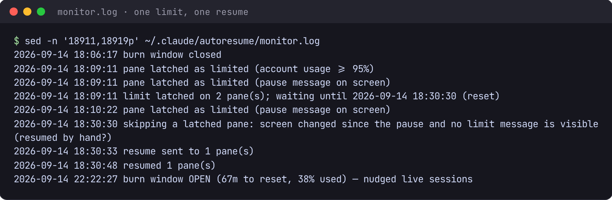
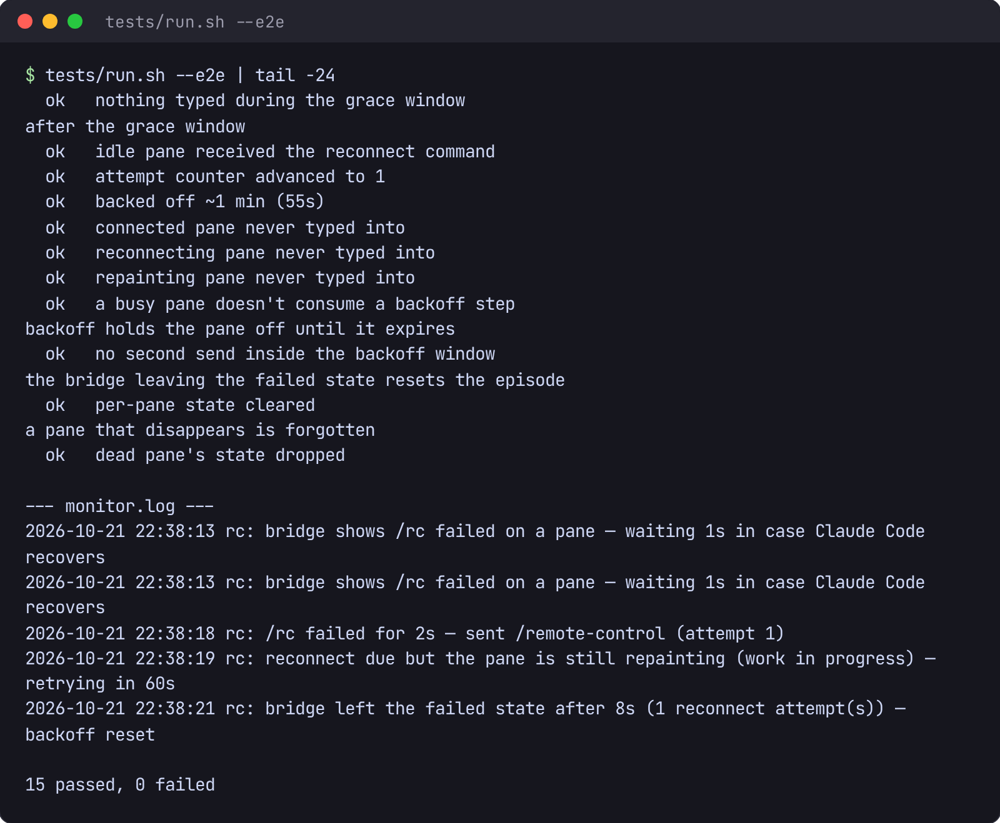

# claude-autoresume

A local `claude` wrapper that resumes rate-limited Claude Code sessions in place.

## The problem

Claude Code stops a session when the account hits its 5-hour usage limit. The conversation stays open and sits idle until someone comes back and types. This wrapper keeps those sessions in tmux and resumes each one once the limit resets.

Only `claude` talks to Anthropic. The wrapper, the monitor, and the status-line patch stay on the machine.

## How it works

`claude` is an alias for [`bin/cc-run`](bin/cc-run). Inside tmux, Claude runs in the current pane. Outside tmux, the launcher uses a private `ccar` socket. Either way the pane is recorded, and one background [`bin/monitor.sh`](bin/monitor.sh) watches every registered pane.



The patched status line writes `used_percentage` and `resets_at` to `state.json` on each render. Busy hooks record turns, subagents, and dialogs. The monitor latches a pane when that account signal says the limit has hit, or when the pause is on the pane's own screen, then waits until `resets_at`. At reset it sends the resume text only when the pane still looks paused: a frozen screen, unchanged since the pause.

Detection, the wait, native passthrough, and the remote-control watchdog are specified in [docs/DESIGN.md](docs/DESIGN.md).

## Screenshots



**One limit, one resume**, from the monitor's own log. Panes latch from either signal: the
account's usage in `state.json`, or the pause message on a pane's screen. At the reset the
monitor leaves alone a pane whose screen changed since the pause, resumes the one still
frozen, and checks that it took. The burn-window lines are the nudge sent to live sessions
when unused quota is about to reset.



**Tests.** 14 suites and 409 checks, five of them end-to-end against a throwaway tmux
server. This tail is the end of the remote-control watchdog's end-to-end suite.

## Install

`tmux` and `python3` need to be on `PATH`. The installer stays on the machine: it checks for both and tells you if either is missing.

```bash
./install.sh
```

Safe to re-run. It:

- marks `bin/*` executable
- copies [`config.example.sh`](config.example.sh) to `config.sh` when that file is absent
- creates `~/.claude/autoresume` (and `panes/`) at mode `0700`
- patches `~/.claude/statusline.py` so the monitor can read the usage signal
- writes the busy hooks into `~/.claude/settings.json`
- aliases `claude` to `bin/cc-run` in `~/.bashrc`
- links `cc-attach` and `cc-cancel` into `~/.local/bin` when that directory is on `PATH`

If a patch can't be applied, it prints the manual step and keeps going.

`CCAR_NO_ALIAS=1` skips the alias. `CLAUDE_DIR` and `BASHRC` retarget the Claude directory and the shell rc. Open a new shell, or `source ~/.bashrc`, before the alias is visible.

## Usage

```bash
claude                  # inside tmux: this pane. outside: the fallback session
claude "fix the bug"    # arguments go to the real claude
claude -c               # continue this directory's last conversation
claude --resume         # Claude Code's session picker
cc-attach               # reattach, or reopen tabs after the server is gone
cc-attach -y            # reopen every saved tab without asking
cc-cancel               # stop the monitor's pending resume
```

Inside tmux, your prefix then `X` is the same cancel (`CCAR_CANCEL_KEY`). Prefix then `d` detaches the fallback session; a later `claude` or `cc-attach` walks back in. Use those commands to attach. They set `TERM` the way the launcher does, so Claude's TUI renders. A hand-rolled `tmux -L ccar attach` uses the shell's `TERM` and garbles the screen.

Non-interactive `claude` is the real CLI: `-p` / `--print`, subcommands (`mcp`, `doctor`, `update`, `auth`, …), `--version`, `--help`, and any piped stdin. The launcher `exec`s `claude`, which bypasses the alias.

A plain `claude` from a shell that already has a wrapped session shows that session and asks before joining. `Y` attaches, on this directory's window when one exists. `N` ends that session, running turns included, and starts over with one window for the current directory.

```
A wrapped session is already running on socket 'ccar':

  1  /home/you/project-a   idle   <- you are here
  2  /home/you/project-b   working
  3  /home/you/project-c   parked at the rate limit

  [Y] attach, on this directory's own window
  [N] end that session — all 3 window(s) above — and start over with just /home/you/project-a

Attach? [Y/n]
```

A prompt, `--resume`, or any other option still gets its own window. Read the state column before answering `N`.

After a reboot or `wsl --shutdown`, tmux has no session to restore. The conversations are still under `~/.claude/projects/`, keyed by directory, and the pane registry still names the tabs that were open. A bare `claude` (or `claude -c`) from a plain shell then offers them in an arrow-key list, including the directory you launched from:

```
  Reopen which sessions?  ↑↓ move · space toggle · a all · n none · enter go · q cancel
 › [x] /home/you/project-a
   [x] /home/you/project-b
   [x] /home/you/project-c
```

Each reopened tab continues its last conversation when one exists, and starts fresh otherwise. `q` falls through to a single new window. `cc-attach` is the same flow, and the entry point when you only want to reattach or reopen. Run it from a plain shell; from inside tmux it stops, because attaching there would nest a server.

### Rendering

Claude's TUI needs `default-terminal tmux-256color` and truecolor (`terminal-features ",*:RGB"`). On your own server, put that in `~/.tmux.conf`. The fallback server loads this repo's [`tmux.conf`](tmux.conf), which sources yours, applies the same caps, and forwards Claude's terminal title to the outer tab. Scroll with tmux copy-mode (prefix then `[`). If Windows Terminal keeps a stale title, the profile's "Suppress title changes" setting is what blocks it.

### Working glyph

Claude's title glyph stays `✳` for a running turn and for an idle prompt. The monitor swaps a leading `✳` on the window name for the state it has published:

```
1:✽ project-a    Claude, running a turn
2:✳ project-b    Claude, idle at the prompt
3:◑ project-c    Claude idle; its subagents are still working
4:⧗ project-d    parked at the limit, waiting for the window to reset
5:✻ project-e    Claude idle; a grok job it started is still running
6:⠏ project-f    Grok, running a turn
7:🚹 project-g    Grok, idle
```

Put that leading `✳` on Claude and Grok window names in `~/.tmux.conf`. Naming windows is tmux's job:

```tmux
set -g automatic-rename on
set -g automatic-rename-format '#{?#{||:#{==:#{pane_current_command},claude},#{==:#{pane_current_command},grok}},✳ ,}#{b:pane_current_path}'
```

A window without the anchor — a shell, an editor — is left as it is. The same swap is applied to the terminal title, so the tab and the taskbar follow the busiest watched pane on that tmux server.

Latch and resume apply to Claude panes. Grok panes on a server that already has a registered Claude pane get glyphs only. The Grok MCP server is published at [claude-code-toolkit](https://github.com/ethanez713/claude-code-toolkit).

### Remote control

Claude Code's own Remote Control reconnects across sleep and network blips when *"Enable Remote Control for all sessions"* is on. What remains is a footer that reads `/rc failed` after that recovery is exhausted. Set `CCAR_RC_ENABLE=1` and the monitor re-types `/remote-control` into a pane it can show is idle. The rules are in [docs/DESIGN.md](docs/DESIGN.md) §8a.

### Operating the monitor

Bash reads `monitor.sh` once, at start. After you edit it, stop the pid in `~/.claude/autoresume/monitor.pid` and run `claude` again (or end the session and start it again).

```bash
tmux -L ccar ls                              # fallback session and windows
tail -f ~/.claude/autoresume/monitor.log     # monitor log
tmux -L ccar kill-session -t cc              # end the fallback session
```

`~/.claude/autoresume/stats.jsonl` is a heartbeat the monitor appends: its CPU over the window, and how many panes were registered, running, and busy. Inspect it with `tail` or `jq`. `CCAR_STATS_SECONDS=0` turns it off.

## Configuration

`./install.sh` copies [`config.example.sh`](config.example.sh) to `config.sh` once and leaves an existing `config.sh` alone. `config.sh` is gitignored; edit that copy. Every tunable is commented there: the fallback socket, resume text, limit threshold, glyph formats, deep-idle timing, clock reconciliation, the cancel key, and the remote-control watchdog (off unless `CCAR_RC_ENABLE=1`).

## Tests

The tests stay on the machine. Where a test has to launch Claude, it puts a stub `claude` on `PATH`. Nothing calls Anthropic.

```bash
tests/run.sh          # unit-style; no tmux server
tests/run.sh --e2e    # also the tests that drive a throwaway tmux server
```

`tests/run.sh` exits non-zero if any script it runs fails. The default set is what CI runs. GitHub-hosted Ubuntu images ship shellcheck and do not ship tmux, so anything that starts a tmux server is behind `--e2e`.

Unit-style, run by default:

| script | covers |
|---|---|
| `tests/attach_plan_test.sh` | what `cc-attach` will reopen, and its guards |
| `tests/busy_glyph_test.sh` | working-vs-idle colour and title checks; tmux stubbed |
| `tests/busy_hook_test.sh` | hook files and `decide_busy` |
| `tests/deep_idle_test.sh` | the quiet wait |
| `tests/launch_join_test.sh` | which launches rejoin an open window |
| `tests/rc_watchdog_test.sh` | remote-control screen reading |
| `tests/tui_test.sh` | the arrow-key pick-list |

These need `tmux` and run only with `--e2e`:

| script | covers |
|---|---|
| `tests/busy_format_test.sh` | glyph formats rendered on a throwaway tmux server |
| `tests/reconstruct_test.sh` | the liveness filter for reopen |
| `tests/attach_rebuild_e2e.sh` | `cc-attach` rebuilding a dead fallback session |
| `tests/busy_glyph_e2e.sh` | a real `monitor.sh` driving the window list |
| `tests/launch_join_e2e.sh` | `claude` from a plain shell when a session is already up |
| `tests/launch_reconstruct_e2e.sh` | `claude` offering tabs after the server is gone |
| `tests/rc_watchdog_e2e.sh` | the watchdog typing into a scratch pane |

## License

[MIT](LICENSE). Copyright (c) 2026 Ethan Zhou.
