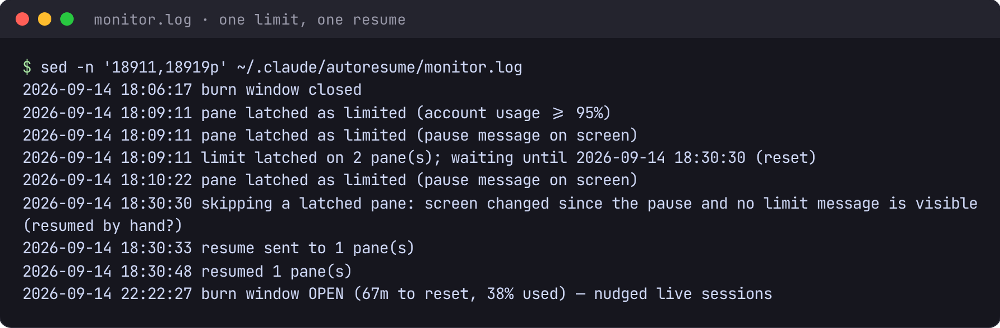
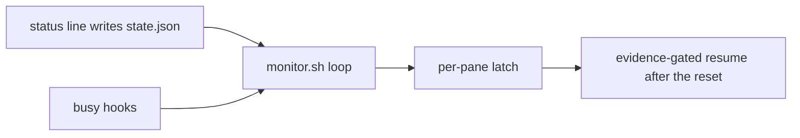

# claude-autoresume

[](https://github.com/ethanez713/claude-autoresume/actions/workflows/ci.yml)

**Claude Code sessions that pick up where they stopped when the usage limit resets.**
Claude Code halts a session at the 5-hour limit and leaves it idle until someone comes
back to type. This keeps sessions in tmux and resumes each one, in place, at the reset,
so a long task started at night is still moving in the morning.

Only `claude` talks to Anthropic. The wrapper, the monitor and the status-line patch
stay on the machine.



**One limit, one resume**, from the monitor's own log. Panes latch from either signal: the
account's usage in `state.json`, or the pause message on a pane's screen. At the reset the
monitor leaves alone a pane whose screen changed since the pause, resumes the one still
frozen, and checks that it took. The burn-window lines are the nudge sent to live sessions
when unused quota is about to reset.

## How it works

`claude` is an alias for [`bin/cc-run`](bin/cc-run). Inside tmux, Claude runs in the current pane. Outside tmux, the launcher uses a private `ccar` socket. Either way the pane is recorded, and one background [`bin/monitor.sh`](bin/monitor.sh) watches every registered pane.



The patched status line writes `used_percentage` and `resets_at` to `state.json` on each render. Busy hooks record turns, subagents, and dialogs. The monitor latches a pane when that account signal says the limit has hit, or when the pause is on the pane's own screen, then waits until `resets_at`. At reset it sends the resume text only when the pane still looks paused: a frozen screen, unchanged since the pause.

Each wrapped session also loads [`mod/`](mod), a Claude Code mod that resumes its own session. It hears the rate-limit stop and reads the reset time from inside Claude, then sends the resume text as a real prompt. While the mod holds a pane, the monitor keeps that pane's glyph and still answers the limit's choice dialog, but leaves the resume to the mod. Sessions without the mod get the monitor's screen-based path.

Detection, the wait, native passthrough, and the remote-control watchdog are specified in [docs/DESIGN.md](docs/DESIGN.md).

## Install

`tmux` and `python3` on `PATH`, then:

```bash
./install.sh
```

It is safe to re-run. It aliases `claude` to the wrapper, patches the status line so the
monitor can read the usage signal, and adds the busy hooks to `~/.claude/settings.json`;
anything it cannot patch, it prints as a manual step. `CCAR_NO_ALIAS=1` skips the alias.

## Use

```bash
claude                  # inside tmux: this pane. outside: the fallback session
claude "fix the bug"    # arguments go to the real claude
claude -c               # continue this directory's last conversation
claude --resume         # Claude Code's session picker
cc-attach               # reattach, or reopen tabs after the server is gone
cc-attach -y            # reopen every saved tab without asking
cc-cancel               # stop the monitor's pending resume
```

Inside a wrapped session, `/autoresume-cancel` drops that session's pending resume.
Reopening tabs after a reboot, the window glyphs, the remote-control watchdog and the
monitor's logs are in [docs/USAGE.md](docs/USAGE.md). Every tunable is commented in
[`config.example.sh`](config.example.sh), which the installer copies to `config.sh`.

## Tests

The tests stay on the machine. Where a test has to launch Claude, it puts a stub `claude` on `PATH`. Nothing calls Anthropic.

```bash
tests/run.sh          # unit-style; no tmux server
tests/run.sh --e2e    # also the tests that drive a throwaway tmux server
```

The mod has its own suite: `claude plugin test mod`.

`tests/run.sh` exits non-zero if any script it runs fails. The default set is what CI runs. GitHub-hosted Ubuntu images ship shellcheck and do not ship tmux, so anything that starts a tmux server is behind `--e2e`.

## License

[MIT](LICENSE). Copyright (c) 2026 Ethan Zhou.
